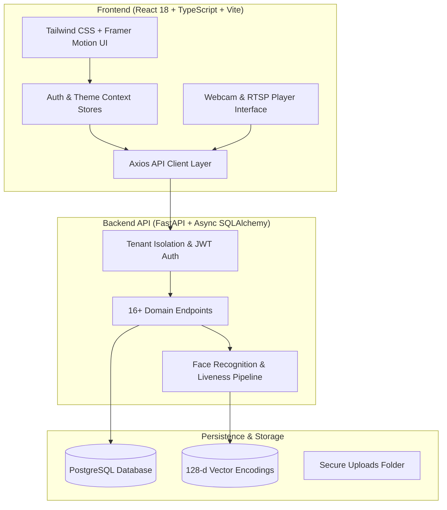

# ATTENDORA — Enterprise AI Face Recognition Attendance SaaS Platform

[](https://react.dev/)
[](https://www.typescriptlang.org/)
[](https://vitejs.dev/)
[](https://fastapi.tiangolo.com/)
[](https://tailwindcss.com/)

**ATTENDORA** is a next-generation, multi-tenant AI attendance SaaS engineered to replace mechanical fingerprint readers and manual logbooks. Powered by sub-500ms facial recognition, live RTSP and webcam stream processing, liveness anti-spoofing verification, multi-shift scheduling, automated dispute corrections, and payroll-ready reporting.

---

## 🏗️ Architecture Overview



---

## ⚡ Key Platform Capabilities

- **High-Accuracy Vision Engine:** 128-dimensional face embeddings with 99.8% verification accuracy and sub-500ms match speed.
- **Liveness & Anti-Spoofing Detection:** Prevents photo/screen spoofing attacks.
- **Hardware Agnostic:** Connects seamlessly to standard USB webcams, tablet kiosks, or existing RTSP security cameras.
- **Multi-Tenant Isolation:** Complete organization data separation with role-based access control (`super_admin`, `org_admin`, `manager`, `member`).
- **Dynamic Shift Engine:** Supports morning, flexi, and overnight shifts with custom grace periods and overtime logging.
- **Biometric Compliance:** Explicit consent recording conforming to GDPR, HIPAA, and biometric privacy regulations.
- **Attendance Corrections:** Multi-level review and dispute approval workflow with audit remarks.
- **Analytics & Exports:** Visual trend graphs, department turnout distribution, and instant export to Microsoft Excel (`.xlsx`), CSV, and PDF.

---

## 🚀 Quickstart Guide

### 1. Prerequisites
- **Node.js** (v18.0.0 or higher)
- **Python** (v3.10 or higher)
- **PostgreSQL** database (optional for production, or local instance)

---

### 2. Backend Setup

```bash
# Navigate to backend directory
cd backend

# Create virtual environment
python -m venv venv

# Activate virtual environment
# Windows:
venv\Scripts\activate
# macOS/Linux:
source venv/bin/activate

# Install dependencies
pip install -r requirements.txt

# Configure environment variables
copy .env.example .env

# Run FastAPI backend server (port 8000)
uvicorn app.main:app --reload --port 8000
```

> **API Documentation:**
> - Interactive Swagger Docs: `http://localhost:8000/docs`
> - ReDoc Specification: `http://localhost:8000/redoc`

---

### 3. Frontend Setup

```bash
# Navigate to frontend directory
cd frontend

# Install npm dependencies
npm install

# Start Vite development server
npm run dev
```

> The application will start at `http://localhost:5173`.
> The Vite dev server automatically proxies all `/api` requests to `http://localhost:8000`.

---

## 🔐 Default Credentials (Seed Data)

| Role | Email | Password |
|---|---|---|
| **Platform Super Admin** | `admin@attendora.com` | `Admin@12345` |
| **Demo Org Admin** | `admin@attendora.ai` | `Admin@123456` |
| **Demo Manager** | `manager@attendora.ai` | `Manager@123456` |

---

## 📁 Repository Structure

```
attendora/
├── backend/
│   ├── app/
│   │   ├── ai/               # Face detection, embeddings, anti-spoofing
│   │   ├── api/              # 16 REST routers (auth, people, attendance, etc.)
│   │   ├── core/             # Database session, JWT security, configuration
│   │   ├── middleware/       # Tenant isolation, security headers
│   │   ├── models/           # SQLAlchemy database entities
│   │   ├── schemas/          # Pydantic schemas and serialization
│   │   ├── services/         # Audit logging and auxiliary services
│   │   └── main.py           # FastAPI application entry point
│   ├── requirements.txt      # Python dependencies
│   └── .env.example          # Backend configuration template
│
└── frontend/
    ├── src/
    │   ├── components/ui/    # 16 Framer Motion UI primitives
    │   ├── layouts/          # DashboardLayout & AuthLayout
    │   ├── pages/
    │   │   ├── auth/         # LoginPage & RegisterPage
    │   │   ├── dashboard/    # Overview, People, Live Camera, Attendance, Analytics...
    │   │   └── LandingPage.tsx
    │   ├── services/         # Axios API client layer with typed endpoints
    │   ├── stores/           # React Context stores (authStore & themeStore)
    │   ├── types/            # Complete TypeScript domain models
    │   ├── App.tsx           # React Router and route guards
    │   ├── main.tsx          # Application mount
    │   └── index.css         # Tailwind & custom scrollbar styles
    ├── package.json
    ├── tailwind.config.ts
    ├── tsconfig.json
    └── vite.config.ts
```

---

## 📄 License
Commercial Enterprise SaaS — All rights reserved © Attendora Inc.
